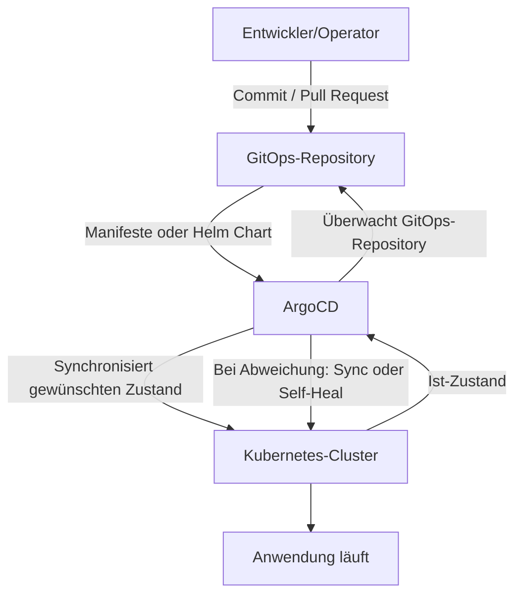

## References

[ArgoCD Tutorial for Beginners](https://www.youtube.com/watch?v=MeU5_k9ssrs)

## Was ist ArgoCD?

Argo CD (meist „ArgoCD“ geschrieben) ist ein Open-Source-Tool für Continuous Delivery von Anwendungen, besonders für Kubernetes.

- Was es macht: Es sorgt dafür, dass dein Kubernetes-Cluster wirklich genau den Zustand hat, der in deiner Git-Quelle definiert ist (z. B. Helm-Charts, Kustomize, Manifeste).
- Wie es arbeitet: Du beschreibst gewünschten Zustand in Git → ArgoCD vergleicht regelmäßig mit dem Ist-Zustand im Cluster → bei Abweichungen kann es automatisch (oder manuell) korrigieren. **ArgoCD ist Teil des Kubernetes-Clusters**.
- Warum man es nutzt: Versionskontrolle, nachvollziehbarer Deploy-Prozess, „Single Source of Truth“ über Git, bessere Rollbacks (weil Änderungen in Git rückgängig gemacht werden können).
- Typische Bausteine: „Applications“ in Argo CD zeigen auf einen Git-Stand (Repo/Branch/Path) und definieren, wie daraus Kubernetes-Ressourcen gerendert werden.
- Continuous Delivery gemacht für Kubernetes basierend auf Git

## Wie funktioniert ein Deployment-Ablauf mit ArgoCD?

    
Der Ablauf:

1. Der Entwickler/Operator ändert Kubernetes-Manifeste oder ein Helm Chart im eigenen GitOps-Repository.
2. ArgoCD erkennt die Änderung.
3. ArgoCD vergleicht den gewünschten Zustand aus Git mit dem tatsächlichen Zustand im Kubernetes-Cluster.
4. Bei einer Synchronisierung werden die Ressourcen im Cluster aktualisiert.
5. ArgoCD überwacht den Cluster weiterhin und kann Abweichungen automatisch korrigieren (`selfHeal`).

**Wichtig:** 
- ArgoCD zieht die Änderungen aus Git in den Cluster. Es wird normalerweise kein Deployment direkt aus der CI-Pipeline in Kubernetes ausgeführt.
- Application Sourcecode und ArgoCD Application configuration sollten in verschiedenen Git-Repositories liegen. Wenn z.B. die gleiche Anwendung auf verschiedenen Clustern installiert ist, kann ich über das GitOps-Repository die Konfiguration unabhängig vom Sourcecode pflegen.

## Was sind die Vorteile von ArgoCD

- Die Anwendungskonfiguration wird in ein Git-Repository verwaltet, mit all den Vorteilen von Git: Versionierung, Pull-Request, usw.
- Lokale Anwendungskonfiguration können nicht mehr auf dem Kubernetes-Cluster "applied" werden. ArgoCD beobachtet auch den Kubernetes Cluster, falls jetzt direkt "kubectl apply" auf den Cluster gemacht wird, merkt das ArgoCD und wendet die Konfiguration im GitOps-Repository wieder an.
- Einfaches Rollback -> git rollback und ArgoCD updated den Cluster automatisch
- Aufsetzen eines neuen Clusters, weil die komplette Cluster Konfiguration im Git-Repository liegt.
- Im Idealfall braucht der Entwickler/Operator brauch keinen Zugriff auf den Kubernetes Cluster, das Berechtigungskonzept wird über das GitOps-Repository gemacht, der Entwickler/Operator macht eine Änderungen in einem Branch, legt einen Pull-Request an und ein "berechtigter" approved diesen Pull-Request/merged die Änderung in den Haupt-Branch. ArgoCD merkt die Änderung und passt den Kubernetes-Cluster entsprechend an.
- Externe Deployment Tools brauchen auch keinen Cluster-Zugriff bzw. Cluster Credentials auch nicht mehr außerhalb gespeichert werden, weil ArgoCD holt sich ja die Änderungen.